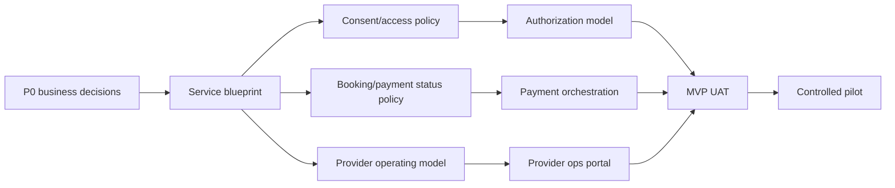

# Kasih Build Timeline Implementation Plan

**Goal:** Membuat timeline pembangunan produk Kasih dari discovery sampai controlled pilot, dengan milestone, dependency, owner, dan exit criteria yang jelas.

**Architecture:** Timeline dibagi menjadi jalur kerja paralel: product/governance, UX/design, engineering foundation, provider operations, security/compliance, QA/UAT, dan pilot readiness. Urutannya sengaja menahan coding besar sampai kebijakan patient-family-consent, provider pilot, payment ownership, dan data boundary cukup jelas.

**Tech Stack:** Belum final. Timeline mengasumsikan arah awal dari PRD/BRD: mobile app, backend API, database dengan row/object-level authorization, payment gateway backend, notification service, file storage dengan scanning, provider/admin portal, analytics/audit logging, dan integrasi eksternal yang diputuskan kemudian.

---

## 1. Timeline Summary

Dokumen ini menerjemahkan PRD Kasih menjadi timeline eksekusi. Estimasi memakai satuan minggu dan dibuat untuk skenario realistis: tim kecil-menengah, greenfield, high-trust healthcare domain, dan butuh validasi legal/clinical/security sebelum pilot.

### 1.1 Recommended Timeline

| Phase | Duration | Calendar Window | Main Outcome |
|---|---:|---|---|
| Phase 0. Product and Governance Alignment | 2 weeks | Week 0-2 | Launch wedge, pilot scope, decision owners, risk boundary |
| Phase 1. Service Blueprint and Policy | 3 weeks | Week 2-5 | Final policy for account/patient/family/booking/payment/support |
| Phase 2. UX Validation and Design System | 3 weeks | Week 4-7 | Tested prototype and design-ready critical flows |
| Phase 3. Technical Foundation | 4 weeks | Week 6-10 | Architecture, environments, auth, base data model, CI/CD |
| Phase 4. MVP Core Build R1 | 6 weeks | Week 10-16 | Self-managed patient can search, book, pay, and get reminders |
| Phase 5. Family and Trust Build R2 | 4 weeks | Week 14-18 | Dependent, adult invite, grants, revoke, audit, dispute |
| Phase 6. Records, Support, and Ops Build R3 | 4 weeks | Week 17-21 | Timeline/document MVP, support, provider ops, reconciliation |
| Phase 7. Hardening, UAT, and Pilot Readiness | 3 weeks | Week 21-24 | Security/UAT pass, runbooks, pilot go/no-go |
| Phase 8. Controlled Pilot | 4-8 weeks | Week 25-32 | Limited launch with partner fasyankes and monitored rollout |

### 1.2 Practical MVP Target

Earliest serious pilot target: **24-28 weeks** from approved kickoff.

Why not faster:

- Healthcare privacy and family consent rules are product-critical, not polish.
- Payment/appointment mismatch can create real operational and financial issues.
- Provider supply must be ready before consumer launch.
- Wrong-patient data and caregiver access disputes need support/runbook readiness.

### 1.3 Parallel Workstreams

| Workstream | Starts | Continues Through | Primary Owner |
|---|---|---|---|
| Product strategy and scope | Week 0 | Week 5 | Product Owner |
| Legal/privacy/clinical governance | Week 0 | Pilot | Legal, clinical governance |
| UX research and prototype | Week 0 | Week 8 | Product design, UX research |
| Architecture/security | Week 2 | Week 24 | Engineering lead, security |
| Mobile app | Week 8 | Week 24 | Mobile lead |
| Backend/platform | Week 6 | Week 24 | Backend lead |
| Provider/admin ops | Week 8 | Week 24 | Ops product, backend/web |
| Payment/finance operations | Week 2 | Week 24 | Finance, backend |
| QA/UAT | Week 8 | Pilot | QA lead |
| Pilot operations | Week 4 | Pilot | Operations lead |

---

## 2. Critical Path

### 2.1 Decisions That Must Happen Early

These block confident engineering planning:

1. Primary launch wedge.
2. Customer/business model.
3. Pilot provider/fasyankes and service types.
4. Patient account vs patient profile policy.
5. Household/care circle vs KK policy.
6. Default access grants for family/caregiver.
7. Guardian/dependent proof level.
8. Merchant of record and refund liability.
9. Record scope for MVP.
10. SATUSEHAT integration stance for MVP: excluded, discovery only, or limited approved use case.

### 2.2 Hard Dependencies

### 2.3 Highest-Risk Items

| Risk | Timeline Treatment |
|---|---|
| Family access leakage | Design, policy, data model, tests start before feature build |
| Payment status mismatch | Payment architecture and reconciliation built before launch readiness |
| Wrong-patient data | Containment and support workflow included before pilot |
| Provider supply not ready | Provider ops and pilot onboarding run in parallel from early phase |
| Scope creep | Release gates split R1/R2/R3; P1/P2 kept out of MVP |

---

## 3. Phase Detail

## Phase 0: Product and Governance Alignment

**Duration:** Week 0-2  
**Goal:** Decide what the first product is, who it serves, and what cannot be compromised.  
**Primary output:** Approved MVP direction and decision log.

### Milestones

| Milestone | Target |
|---|---|
| Kickoff completed | Week 0 |
| P0 decision workshop completed | Week 1 |
| Pilot wedge selected | Week 1 |
| Initial risk register approved | Week 2 |
| MVP release definition approved | Week 2 |

### Work Items

1. Review PRD and Material 3 Figma prototype with stakeholders.
2. Decide primary launch wedge. Recommended: outpatient booking plus family coordination.
3. Identify first pilot provider/fasyankes candidates.
4. Confirm whether app starts B2C, B2B2C, or provider-sponsored.
5. Confirm MVP excludes diagnosis, emergency handling, broad SATUSEHAT sync, insurance claim, e-prescription.
6. Assign decision owners for identity, family access, provider ops, payment, support, legal, clinical governance, and security.
7. Create decision log.
8. Create risk register.

### Exit Criteria

- P0 decisions have named owners and draft answers.
- MVP wedge is approved.
- Pilot partner path is realistic.
- No stakeholder expects MVP to be full RME, emergency app, or diagnosis tool.
- Legal/clinical/security owners agree on high-risk areas.

### Deliverables

- `docs/product/2026-10-02-e-patient-prd.md`
- `docs/plans/2026-10-04-e-patient-build-timeline.md`
- Create later: `docs/product/decision-log.md`
- Create later: `docs/product/risk-register.md`

---

## Phase 1: Service Blueprint and Policy

**Duration:** Week 2-5  
**Goal:** Convert PRD into operationally valid service rules before large engineering build.  
**Primary output:** Signed-off policies and service blueprint.

### Milestones

| Milestone | Target |
|---|---|
| Account/patient/family model workshop | Week 2 |
| Booking/payment/refund policy workshop | Week 3 |
| Provider ops blueprint | Week 3 |
| Support/dispute runbook draft | Week 4 |
| Policy signoff checkpoint | Week 5 |

### Work Items

1. Finalize account vs patient profile model.
2. Finalize identity assurance levels.
3. Finalize household/care circle model.
4. Finalize dependent and adult invitation rules.
5. Define access grant scopes for MVP:
   - Appointment
   - Payment
   - Basic profile
   - Documents, if allowed in MVP
   - No default full clinical record
6. Define booking state machine.
7. Define payment/refund state machine.
8. Define provider cancellation and refund options.
9. Define wrong-patient data containment workflow.
10. Define support elevated access approval rules.
11. Define data retention and deletion boundaries.
12. Define analytics allowlist.

### Exit Criteria

- Consent/access matrix is approved.
- Booking/payment/refund status machine is approved.
- Support can suspend access grant without deleting audit.
- Finance owns merchant/refund/chargeback decisions.
- Provider ops knows catalog, schedule, check-in, cancellation responsibilities.

### Deliverables

- Create: `docs/product/account-patient-family-policy.md`
- Create: `docs/product/consent-access-matrix.md`
- Create: `docs/product/booking-payment-status-machines.md`
- Create: `docs/operations/provider-service-blueprint.md`
- Create: `docs/operations/support-dispute-runbook.md`
- Create: `docs/security/data-classification-and-analytics-allowlist.md`

---

## Phase 2: UX Validation and Design System

**Duration:** Week 4-7  
**Goal:** Validate critical UX tasks before committing to full build.  
**Primary output:** Tested prototype and design-ready MVP screens.

### Milestones

| Milestone | Target |
|---|---|
| Prototype review from PRD | Week 4 |
| Usability test round 1 | Week 5 |
| Material 3 design refinement | Week 6 |
| Critical flow validation | Week 7 |

### Work Items

1. Use Figma page `03 Material 3 UX Improved` as starting point.
2. Validate onboarding and self-profile flow.
3. Validate add dependent vs invite adult distinction.
4. Validate access grant scope selection.
5. Validate revoke access flow.
6. Validate booking for family member flow.
7. Validate payment pending and confirmed states.
8. Validate record source labeling.
9. Validate wrong-patient report.
10. Validate support ticket and family dispute entry.
11. Test with:
    - Adult self-managed patient
    - Parent/guardian
    - Caregiver for elderly/dependent
    - Fasyankes/admin staff
12. Update UX copy for low literacy and Bahasa Indonesia MVP.

### Exit Criteria

- Critical privacy/safety tasks pass agreed usability threshold.
- Users understand household does not mean medical access.
- Users can identify user-added vs provider-linked records.
- Users can understand payment pending vs paid.
- Designers and product agree on component patterns.

### Deliverables

- Updated Figma prototype.
- Create: `docs/research/ux-validation-plan.md`
- Create: `docs/research/ux-validation-findings.md`
- Create: `docs/design/material-3-product-guidelines.md`
- Create: `docs/product/mvp-copy-guidelines-id.md`

---

## Phase 3: Technical Foundation

**Duration:** Week 6-10  
**Goal:** Prepare architecture, environments, security foundation, and delivery workflow.  
**Primary output:** Engineering foundation ready for feature build.

### Milestones

| Milestone | Target |
|---|---|
| Architecture decision records drafted | Week 6 |
| Repository/app scaffolding | Week 7 |
| Auth and base API skeleton | Week 8 |
| Database and authorization design reviewed | Week 9 |
| CI/CD and test pipeline ready | Week 10 |

### Work Items

1. Decide client platform and architecture.
2. Decide backend architecture.
3. Decide database and authorization model.
4. Decide provider/admin portal approach.
5. Decide payment gateway for MVP.
6. Set up environments:
   - Local
   - Development
   - Staging
   - Pilot production
7. Create CI pipeline.
8. Create secret management approach.
9. Create audit logging pattern.
10. Create object-level authorization testing pattern.
11. Create analytics event schema allowlist.
12. Create file upload storage and scanning architecture.
13. Create notification service abstraction.

### Exit Criteria

- ADRs are reviewed.
- CI runs tests and lint.
- Staging environment exists.
- Auth skeleton works in staging.
- Authorization strategy is documented and testable.
- Security owner approves foundation.

### Deliverables

- Create: `docs/architecture/adr-001-client-platform.md`
- Create: `docs/architecture/adr-002-backend-platform.md`
- Create: `docs/architecture/adr-003-identity-household-data-model.md`
- Create: `docs/architecture/adr-004-authorization-and-audit.md`
- Create: `docs/architecture/adr-005-payment-orchestration.md`
- Create: `docs/architecture/adr-006-file-storage-and-record-provenance.md`
- Create: `docs/security/threat-model.md`
- Create: `docs/testing/test-strategy.md`
- Create: `docs/product/analytics-event-spec.md`

---

## Phase 4: MVP Core Build R1 - Self Care Access

**Duration:** Week 10-16  
**Goal:** Build the first usable path for self-managed adult patient: browse, book, pay, get reminders.  
**Primary output:** R1 end-to-end flow working in staging.

### Milestones

| Milestone | Target |
|---|---|
| Auth/profile vertical slice | Week 11 |
| Directory/catalog vertical slice | Week 12 |
| Booking draft/hold/confirm | Week 14 |
| Payment pending/paid flow | Week 15 |
| R1 internal demo | Week 16 |

### Feature Scope

#### Mobile

- Sign up/login.
- Contact verification.
- Self patient profile.
- Patient switcher with one self profile.
- Care search.
- Provider/service detail.
- Slot selection.
- Booking review.
- Pre-visit form.
- Payment pending/confirmed.
- Appointment detail.
- Reminder display.

#### Backend

- User account.
- Patient profile.
- Provider/fasyankes catalog.
- Service catalog.
- Slot/booking state.
- Payment order.
- Payment webhook.
- Notification scheduling.
- Audit baseline.

#### Provider/Admin

- Provider setup.
- Service catalog.
- Schedule/slot setup.
- Booking worklist.
- Payment status view.

### Exit Criteria

- Self-managed adult can complete booking in staging.
- Payment status is server-verified.
- Booking and payment states remain separate.
- Provider/admin can see booking and payment state.
- Reminder is scheduled and cancellable.
- Critical R1 tests pass.

### Key Tests

- Registration and profile creation.
- Search and provider detail.
- Slot hold expiry.
- Payment webhook idempotency.
- Client redirect cannot mark paid.
- Reminder cancellation after booking cancellation.
- Basic provider worklist status transition.

---

## Phase 5: Family and Trust Build R2

**Duration:** Week 14-18  
**Goal:** Build family/caregiver coordination safely.  
**Primary output:** Dependent and adult invite flows with revocable grants and audit.

### Milestones

| Milestone | Target |
|---|---|
| Dependent profile flow | Week 15 |
| Adult invite flow | Week 16 |
| Access grant enforcement | Week 17 |
| Revoke/dispute support | Week 18 |

### Feature Scope

#### Mobile

- Care circle/household hub.
- Add dependent.
- Invite adult/caregiver.
- Accept/decline invite.
- Grant scope selection.
- Booking for dependent.
- Payer-only flow.
- Revoke grant.
- Privacy center grant list.

#### Backend

- Household/care circle.
- Relationship model.
- Access grant model.
- Authorization by patient/profile/scope.
- Invite tokens.
- Revoke and token invalidation.
- Dispute/suspension state.
- Audit for actor vs patient.

#### Support/Admin

- View access dispute.
- Suspend grant.
- View audit metadata without clinical overexposure.

### Exit Criteria

- Household membership alone grants no medical access.
- Adult invite shares no data before acceptance.
- Appointment/payment-only grant cannot view clinical data.
- Revoke blocks future access and deep links.
- Payer can pay without diagnosis visibility.
- Cross-profile authorization tests pass.

### Key Tests

- UAT-002 to UAT-007.
- Object-level access tests for each grant scope.
- Revoked caregiver with active session cannot access next request.
- Support suspension blocks access without deleting audit.

---

## Phase 6: Records, Support, and Ops Build R3

**Duration:** Week 17-21  
**Goal:** Add records MVP, support flows, provider ops readiness, and reconciliation.  
**Primary output:** MVP is operationally supportable.

### Milestones

| Milestone | Target |
|---|---|
| Timeline/document MVP | Week 18 |
| Wrong-patient report | Week 19 |
| Support tickets | Week 19 |
| Reconciliation queue | Week 20 |
| Ops readiness demo | Week 21 |

### Feature Scope

#### Mobile

- Timeline per patient.
- User document upload.
- User-added/non-verified label.
- Record detail.
- Wrong-record report.
- Notification center.
- Support ticket.
- Data rights request entry point.

#### Backend

- Health record item.
- File upload validation.
- Malware scanning integration or stubbed pilot workflow.
- Source/provenance metadata.
- Wrong-patient quarantine.
- Support ticket model.
- Notification deep link auth check.
- Reconciliation exceptions.

#### Provider/Admin/Ops

- Reconciliation dashboard.
- Support ticket queue.
- Correction/wrong-patient queue.
- Audit queue.
- Basic operational metrics.

### Exit Criteria

- Timeline does not leak cross-profile data.
- User-added document is always marked non-verified.
- Wrong-patient report can hide/quarantine item.
- Support can route account/booking/payment/data/family issues.
- Finance can identify payment exceptions.
- Notification deep links re-check session and grant.

### Key Tests

- UAT-014 to UAT-020.
- File upload validation.
- Cross-profile record authorization.
- Wrong-patient containment.
- Support least-privilege access.
- Payment reconciliation exception flow.

---

## Phase 7: Hardening, UAT, and Pilot Readiness

**Duration:** Week 21-24  
**Goal:** Prepare a limited but safe controlled pilot.  
**Primary output:** Go/no-go decision.

### Milestones

| Milestone | Target |
|---|---|
| End-to-end regression | Week 21 |
| Security testing complete | Week 22 |
| UAT complete | Week 23 |
| Pilot runbooks and training | Week 23 |
| Go/no-go | Week 24 |

### Work Items

1. Execute full UAT suite.
2. Run cross-profile authorization tests.
3. Run payment idempotency tests.
4. Run backup/restore drill.
5. Run incident tabletop:
   - Wrong-patient data
   - Account takeover
   - Payment mismatch
   - Provider cancellation
   - Family access dispute
6. Review analytics/logs for sensitive data leakage.
7. Review accessibility for critical flows.
8. Train provider/admin/support/finance pilot users.
9. Validate support SLA and escalation path.
10. Freeze pilot scope.

### Exit Criteria

- All critical UAT scenarios pass.
- No critical/high security issue remains open.
- Legal/privacy/clinical signoff complete.
- Pilot provider operations trained.
- Payment reconciliation daily workflow ready.
- Support coverage ready.
- Go/no-go approved by decision owners.

### Pilot Go Checklist

- Consent/access audit reconstructable.
- Cross-profile authorization tests pass 100% for critical cases.
- Client cannot mark paid.
- Wrong-patient containment works.
- Lock-screen notification avoids sensitive data.
- Support elevated access is approved/time-bound/audited.

---

## Phase 8: Controlled Pilot

**Duration:** Week 25-32  
**Goal:** Launch to limited users/provider scope, measure reliability and trust signals, and expand only when safe.  
**Primary output:** Pilot learnings and expansion decision.

### Pilot Shape

| Dimension | Recommendation |
|---|---|
| Region | One city/cluster |
| Provider | 1-3 partner fasyankes |
| Services | 1-2 low-complexity service types |
| Users | Allowlisted or invitation cohort |
| Family access | Enabled but monitored |
| Records | User-uploaded docs and limited provider summaries only if approved |
| Payment | One gateway and one merchant model |
| Support | Dedicated pilot queue |

### Week-by-Week Pilot

| Week | Focus |
|---|---|
| Week 25 | Soft launch to internal/friendly users |
| Week 26 | Provider staff workflow stabilization |
| Week 27 | First real patient cohort |
| Week 28 | Family coordination cohort |
| Week 29 | Payment/refund exception review |
| Week 30 | Records/support workflow review |
| Week 31 | Metrics and incident drill review |
| Week 32 | Expand, iterate, or pause decision |

### Pilot Metrics

- Registration completion.
- Self-profile completion.
- Search to booking.
- Booking confirmed to attended.
- Payment pending to paid.
- Payment mismatch rate.
- Provider cancellation/no-show.
- Reminder open/action rate.
- Family invite accepted.
- Access dispute rate.
- Unauthorized access report rate.
- Wrong-patient report rate.
- Support contact per booking.
- Crash-free sessions.

### Exit Criteria

- No severe privacy/security incident.
- Payment reconciliation stable.
- Provider operations can sustain daily usage.
- Support volume manageable.
- Funnel shows enough value to justify expansion.
- Guardrail metrics within agreed threshold.

---

## 4. Release Roadmap

### R0: Discovery and Policy

**Timeline:** Week 0-5  
**Ships:** No production app  
**Outcome:** Scope and governance ready

### R1: Self Care Access

**Timeline:** Week 6-16  
**Ships:** Adult self-managed booking and payment staging build  
**Outcome:** One adult patient can book/pay without family features

### R2: Family Coordination

**Timeline:** Week 14-18  
**Ships:** Dependent, adult invite, grant, revoke, audit  
**Outcome:** Family can help safely without broad access

### R3: Health Timeline and Support

**Timeline:** Week 17-21  
**Ships:** Document timeline, wrong-record report, support, reconciliation  
**Outcome:** App is operationally supportable

### R4: Pilot MVP

**Timeline:** Week 21-24 hardening, Week 25+ pilot  
**Ships:** Limited production pilot  
**Outcome:** Measured real-world readiness

### R5: Care Continuity

**Timeline:** After pilot stability  
**Ships:** Medication reminder, preventive care, measurements, growth chart  
**Outcome:** Product expands beyond booking into longitudinal care

### R6: Interoperability

**Timeline:** After partner/legal approval  
**Ships:** Limited SATUSEHAT/provider-linked use cases  
**Outcome:** Structured health data integration without overclaiming scope

---

## 5. Team and Ownership Plan

### 5.1 Minimum Team

| Role | Needed From | Notes |
|---|---|---|
| Product Owner | Week 0 | Decision owner and backlog owner |
| Product Designer/UX Researcher | Week 0 | Prototype and usability validation |
| Engineering Lead | Week 2 | Architecture and delivery sequencing |
| Backend Engineer | Week 6 | Auth, patient, booking, payment, audit |
| Mobile Engineer | Week 8 | Patient app |
| Web/Ops Engineer | Week 8 | Provider/admin portal |
| QA Engineer | Week 8 | UAT, regression, automation |
| Security/Privacy | Week 0 | Threat model, audit, access controls |
| Legal/Clinical Governance | Week 0 | Consent, record, emergency boundaries |
| Provider Ops Lead | Week 2 | Partner workflow and staff readiness |
| Support/Finance Lead | Week 2 | Refund, dispute, reconciliation |

### 5.2 RACI Snapshot

| Area | Responsible | Accountable | Consulted |
|---|---|---|---|
| MVP scope | Product | Sponsor/Product Owner | Engineering, ops, legal |
| Consent/access policy | Product, legal | Product Owner | Security, clinical |
| Patient data model | Engineering | Engineering Lead | Product, security, legal |
| Booking workflow | Product, engineering | Product Owner | Provider ops |
| Payment/refund | Backend, finance | Finance Owner | Product, support |
| Provider ops | Ops product | Operations Lead | Engineering, provider |
| Security tests | Security, QA | Security Owner | Engineering |
| UAT | QA, product | Product Owner | Ops, support |
| Pilot go/no-go | Product, ops, security | Sponsor | All decision owners |

---

## 6. Milestone Checklist

### Week 2 Checklist

- [ ] Launch wedge approved.
- [ ] Pilot provider shortlist created.
- [ ] Decision owners assigned.
- [ ] MVP non-goals accepted.
- [ ] Risk register started.

### Week 5 Checklist

- [ ] Account/patient/family policy approved.
- [ ] Consent/access matrix approved.
- [ ] Booking/payment/refund state machines approved.
- [ ] Provider service blueprint approved.
- [ ] Support dispute runbook drafted.

### Week 7 Checklist

- [ ] Critical UX flows tested.
- [ ] Family access confusion reduced to acceptable level.
- [ ] Payment pending/paid state understood by test users.
- [ ] Record provenance labels understood.
- [ ] Design patterns ready for engineering handoff.

### Week 10 Checklist

- [ ] ADRs drafted.
- [ ] Environments created.
- [ ] Auth skeleton works.
- [ ] CI/test pipeline works.
- [ ] Authorization model reviewed.

### Week 16 Checklist

- [ ] Self-managed booking works end-to-end.
- [ ] Payment webhook verifies paid state.
- [ ] Provider sees booking worklist.
- [ ] Reminder flow works.
- [ ] R1 internal demo approved.

### Week 18 Checklist

- [ ] Dependent profile works.
- [ ] Adult invite works.
- [ ] Grant scopes enforced server-side.
- [ ] Revoke blocks access.
- [ ] Access dispute can suspend grant.

### Week 21 Checklist

- [ ] Timeline/document MVP works.
- [ ] Wrong-record report works.
- [ ] Support ticket queue works.
- [ ] Reconciliation exceptions visible.
- [ ] Notification deep links re-check authorization.

### Week 24 Checklist

- [ ] UAT passes.
- [ ] Security tests pass.
- [ ] Accessibility blockers resolved.
- [ ] Provider/admin/support trained.
- [ ] Go/no-go completed.

---

## 7. Engineering Epic Breakdown

### Epic E1: Identity and Patient Foundation

**Target:** Week 6-11  
**Depends on:** Account/patient policy  
**Includes:**

- Authentication.
- Contact verification.
- Session/device management.
- Self patient profile.
- Verification level.
- Duplicate flag.
- Patient context switcher.
- Audit baseline.

### Epic E2: Provider Supply and Directory

**Target:** Week 8-12  
**Depends on:** Provider pilot and catalog policy  
**Includes:**

- Provider/fasyankes profile.
- Service catalog.
- Provider verification status.
- Search and filters.
- Provider detail.
- Schedule freshness.

### Epic E3: Booking Engine

**Target:** Week 10-14  
**Depends on:** Status machine and provider schedule  
**Includes:**

- Slot search.
- Slot hold.
- Booking draft/review.
- Pre-visit form.
- Booking status.
- Reschedule/cancel.
- Provider cancellation.
- QR/check-in baseline.

### Epic E4: Payment and Reconciliation

**Target:** Week 12-16  
**Depends on:** Merchant/refund decision  
**Includes:**

- Invoice/order.
- Payment gateway backend.
- Webhook verification.
- Idempotency.
- Receipt.
- Refund status.
- Reconciliation exception.

### Epic E5: Family, Grants, and Authorization

**Target:** Week 14-18  
**Depends on:** Consent/access matrix  
**Includes:**

- Care circle.
- Dependent.
- Adult invite.
- Access grant.
- Scope enforcement.
- Revoke.
- Suspension/dispute.
- Cross-profile authorization tests.

### Epic E6: Records and Documents MVP

**Target:** Week 17-21  
**Depends on:** Record scope policy  
**Includes:**

- Timeline.
- User document upload.
- Source/provenance label.
- Wrong-patient report.
- Quarantine.
- Record detail.
- Optional provider-linked summary if approved.

### Epic E7: Notification, Calendar, and Privacy Center

**Target:** Week 15-21  
**Depends on:** Notification channel policy  
**Includes:**

- Appointment reminders.
- Notification center.
- Deep link authorization.
- Quiet hours.
- Privacy center.
- Consent list.
- Audit activity.

### Epic E8: Support and Ops Console

**Target:** Week 16-21  
**Depends on:** Support runbook  
**Includes:**

- Support tickets.
- Family dispute queue.
- Payment dispute view.
- Wrong-patient queue.
- Elevated access workflow.
- Audit queue.
- Provider/admin role separation.

### Epic E9: Hardening and Pilot Launch

**Target:** Week 21-24  
**Depends on:** Feature completion  
**Includes:**

- Regression.
- Security testing.
- Accessibility testing.
- UAT.
- Runbooks.
- Training.
- Observability dashboard.
- Launch checklist.

---

## 8. Testing Timeline

### Week 6-10: Foundation Testing

- Unit tests for model validation.
- Auth and session tests.
- Authorization test harness.
- Audit log tests.
- CI smoke tests.

### Week 10-16: Core Flow Testing

- Booking state machine tests.
- Payment idempotency tests.
- Provider catalog/search tests.
- Reminder scheduling tests.
- API contract tests.

### Week 14-18: Family Access Testing

- Cross-profile authorization tests.
- Grant scope matrix tests.
- Invite accept/decline tests.
- Revoke and suspended access tests.
- Payer-only restriction tests.

### Week 17-21: Records and Ops Testing

- Timeline isolation tests.
- File upload validation tests.
- Wrong-patient quarantine tests.
- Support least-privilege tests.
- Reconciliation exception tests.

### Week 21-24: Release Testing

- Full UAT suite.
- Penetration/security assessment.
- Accessibility review.
- Load sanity test for search/booking/payment callback.
- Backup/restore drill.
- Incident simulation.

---

## 9. Pilot Launch Controls

### 9.1 Feature Flags

Use feature flags for:

- Family invite.
- Dependent profile.
- Payment gateway live mode.
- QR check-in.
- Document upload.
- Provider-linked record publishing.
- Data export/share.
- SATUSEHAT integration if later approved.

### 9.2 Rollout Stages

| Stage | Users | Purpose |
|---|---:|---|
| Internal dogfood | 10-30 | Catch obvious UX/ops/security issues |
| Friendly pilot | 50-100 | Validate real provider workflow |
| Controlled patient cohort | 200-500 | Measure funnel and support load |
| Expanded pilot | 1,000+ | Only after guardrails stable |

### 9.3 Stop/Pause Criteria

Pause rollout if:

- Unauthorized cross-profile access is confirmed.
- Payment duplicate or mismatch cannot be reconciled within SLA.
- Wrong-patient record exposure occurs without containment.
- Provider cannot sustain schedule accuracy.
- Support queue exceeds agreed SLA.
- Critical app crash or auth failure blocks booking.

---

## 10. 12-Month Outlook

### Months 1-2

- Product/governance alignment.
- UX validation.
- Architecture foundation.

### Months 3-4

- R1 self-care access.
- R2 family coordination.
- Payment/provider ops integration.

### Months 5-6

- R3 records/support/ops.
- UAT/hardening.
- Controlled pilot.

### Months 7-8

- Pilot iteration.
- Provider onboarding improvements.
- Care continuity P1 planning.
- Medication/reminder and preventive care implementation.

### Months 9-10

- Measurements, growth chart, provider-linked records if approved.
- Data export/share subset with expiry.
- More granular caregiver support.

### Months 11-12

- Interoperability readiness.
- SATUSEHAT use case only if legally/technically approved.
- Expansion to more providers/regions.
- Monetization experiments if guardrails stable.

---

## 11. What Not to Build Yet

Do not start these before MVP pilot proves core trust and operations:

- AI diagnosis or automated treatment recommendation.
- Full RME replacement.
- Emergency response workflow.
- Insurance claim automation.
- Pharmacy fulfillment.
- Broad SATUSEHAT sync.
- Employer/corporate wellness dashboards.
- Full shared family clinical record by default.
- Telemedicine/home care unless operational governance is ready.

---

## 12. References

- PRD: `docs/product/2026-10-02-e-patient-prd.md`
- BRD: `docs/plans/2026-09-30-e-patient-business-requirements.md`
- Figma: https://www.figma.com/design/cmjvwgZ153ZAFlQ3cU4QWz
- Primary Figma page: `03 Material 3 UX Improved`

